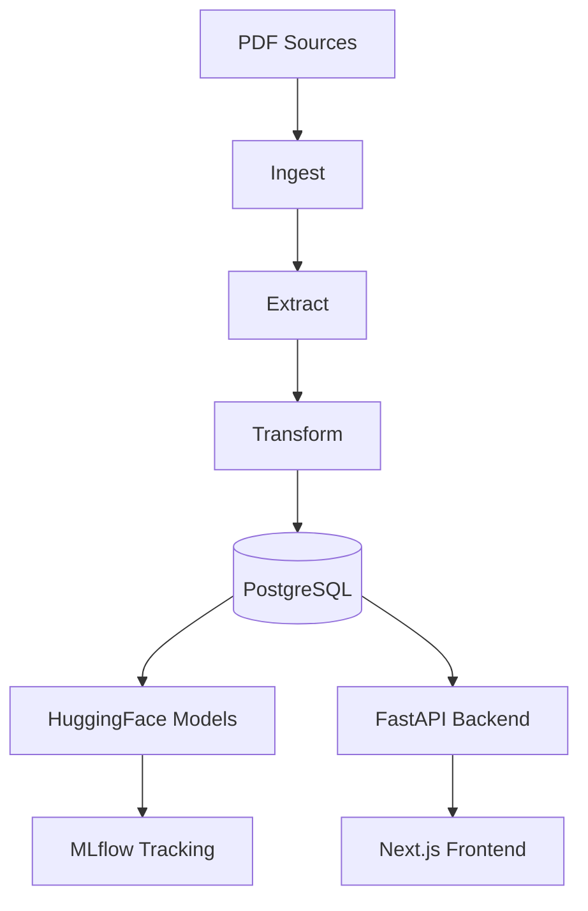

# CivicLens — Legislative Data Pipeline & NLP Intelligence Platform

CivicLens is a comprehensive Data Engineering + MLOps portfolio project that processes government PDFs using HuggingFace models, with a FastAPI backend and Next.js frontend. It includes a full ETL pipeline, PostgreSQL data warehouse, MLflow experiment tracking, and data quality checks.

## Architecture



## Tech Stack

| Layer          | Technology               | Purpose                                  |
|----------------|--------------------------|------------------------------------------|
| Frontend       | Next.js, TypeScript, Tailwind CSS | User interface for document analysis     |
| Backend        | FastAPI (Python)         | API server for handling requests         |
| AI Models      | HuggingFace Transformers | Summarization and sentiment analysis     |
| ETL Pipeline   | Python, pdfplumber       | Ingest, extract, transform, load PDFs    |
| Data Warehouse | PostgreSQL               | Store documents and insights             |
| Experiment Tracking | MLflow             | Track model inference runs and metrics   |
| Infrastructure | Docker Compose           | Orchestrate all services                 |

## Pipeline

The ETL pipeline processes PDFs through these steps:
1. **Ingest**: Download PDFs from URLs or local files to `data/raw/`
2. **Extract**: Extract text using pdfplumber, save to `data/processed/`
3. **Transform**: Clean text and split into chunks for model input
4. **Load**: Insert data into PostgreSQL with upserts to avoid duplicates
5. **Data Quality Checks**: Validate data integrity after loading

### Run the Pipeline

```bash
# Install dependencies
cd pipeline
pip install -r requirements.txt

# Run full pipeline
python run_pipeline.py --source "https://example.com/document.pdf" "/path/to/local/file.pdf" --mode full
```

## Data Schema

### documents Table
| Column         | Type      | Description                              |
|----------------|-----------|------------------------------------------|
| id             | SERIAL    | Primary key                              |
| filename       | TEXT      | Name of the PDF file                     |
| source_url     | TEXT      | Source URL or local path                 |
| ingested_at    | TIMESTAMP | When the document was ingested           |
| raw_text       | TEXT      | Extracted text from the PDF              |
| word_count     | INT       | Number of words in the document          |
| page_count     | INT       | Number of pages in the PDF               |

### insights Table
| Column             | Type      | Description                              |
|--------------------|-----------|------------------------------------------|
| id                 | SERIAL    | Primary key                              |
| document_id        | INT       | Foreign key to documents.id              |
| summary            | TEXT      | Generated summary of the document        |
| sentiment_label    | TEXT      | Sentiment classification (POSITIVE/NEGATIVE) |
| sentiment_score    | FLOAT     | Confidence score for sentiment           |
| model_name         | TEXT      | Name of the model used                   |
| generated_at       | TIMESTAMP | When the insight was generated           |

## MLflow

MLflow tracks all model inference runs with parameters, metrics, and artifacts.

### View MLflow UI

```bash
# Local
mlflow ui --backend-store-uri ./mlruns

# Or via Docker (if using docker-compose)
# The mlflow service is already running on port 5000
```

Open http://localhost:5000 in your browser.

## Getting Started

### Prerequisites
- Docker and Docker Compose
- Python 3.9+ (for running pipeline locally)

### Setup

1. **Clone the Repository**
   ```bash
   git clone <repository-url>
   cd Civiclens
   ```

2. **Create .env File**
   ```bash
   cp .env.example .env
   # Edit .env with your values (optional - defaults work for local dev)
   ```

3. **Start Services with Docker Compose**
   ```bash
   docker-compose up -d
   ```
   This starts:
   - Frontend on http://localhost:3000
   - Backend on http://localhost:8000
   - PostgreSQL on port 5432
   - MLflow on http://localhost:5000

4. **Run the ETL Pipeline**
   ```bash
   cd pipeline
   pip install -r requirements.txt
   python run_pipeline.py --source "/path/to/your/document.pdf"
   ```

## Features

- **AI-Powered Analysis**: Utilize artificial intelligence to analyze legislative documents and extract key insights.
- **Summaries**: Get concise summaries of complex legislative documents.
- **Interactive Dashboard**: Access a dashboard to view and manage your analyses.
- **Sentiment Analysis**: Analyze the sentiment of legislative documents to understand public opinion.
- **Full ETL Pipeline**: End-to-end data processing from PDFs to database.
- **MLflow Tracking**: Track model inference with metrics and artifacts.
- **Data Quality Checks**: Validate data integrity automatically.

## Contributing

Contributions are welcome! Please feel free to submit a Pull Request.
